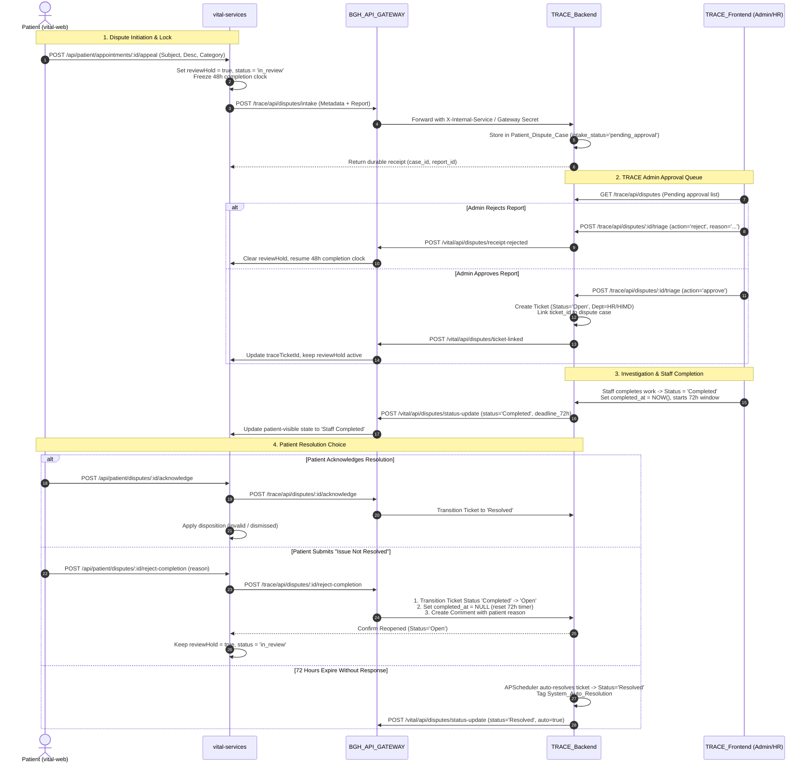

# VITAL–TRACE In-System Dispute Resolution Implementation Plan

**Target Systems:** `vital-services`, `vital-web`, `BGH_API_GATEWAY`, `TRACE_Backend`, `TRACE_Frontend`  
**Reference Document:** `./VITAL_Feedback_on_TRACE_Integration_Plan.md`  
**Document Status:** Architecture & Implementation Plan for Cross-Service Execution  
**Last Updated:** 20 November 2026  

---

## 1. Executive Summary & Purpose

This document operationalizes the transition from the legacy Google Forms telemedicine dispute workflow to a **native in-system dispute resolution architecture**. It incorporates all architectural agreements, clarifications on boundaries and user permissions, UI/UX requirements for TRACE and VITAL, and explicit state machine transitions for dispute handling.

All cross-service communications between `vital-services`, `vital-web`, and `TRACE_Backend` are mediated strictly by **`BGH_API_GATEWAY`** with authenticated headers and `X-Correlation-ID` propagation.

```
+---------------------------------------------------------------------------------------------------------+
|                                    BGH UNIFIED DISPUTE ARCHITECTURE                                     |
|                                                                                                         |
|   +-----------------------+              +-----------------------+              +-------------------+   |
|   |       VITAL Web       |              |    BGH API Gateway    |              |   TRACE Frontend  |   |
|   |  - Report Modal       |              |  - Route Auth & Proxy |              |  - Feedback Hub   |   |
|   |  - Progress Tracker   |              |  - Header Injection   |              |  - /dispute Queue |   |
|   |  - Acknowledge/Reject |              |  - Correlation ID     |              |  - Admin Approval |   |
|   +-----------+-----------+              +-----------+-----------+              +---------+---------+   |
|               |                                      |                                    |             |
|               v                                      v                                    v             |
|   +-----------+-----------+              +-----------+-----------+              +---------+---------+   |
|   |    VITAL Services     |<------------>|  Gateway Route Mesh   |<------------>|   TRACE Backend   |   |
|   |  - Hold State Machine |              |  /trace/api/disputes  |              |  - Pending Queue  |   |
|   |  - 48h Lock Freeze    |              |  /vital/api/disputes  |              |  - Ticket Engine  |   |
|   |  - Dispositions       |              |                       |              |  - 72h Scheduler  |   |
|   +-----------------------+              +-----------------------+              +-------------------+   |
+---------------------------------------------------------------------------------------------------------+
```

---

## 2. Core Clarifications & Architectural Agreements

### 2.1 VITAL Metadata & Clinical Privacy Boundary
* **Identifiers Transmitted**: VITAL supplies `appointment_id`, `doctor_id`, `patient_id`, and `reporter_auth_id` (Auth-owned UUID) as metadata.
* **Clinical Privacy Quarantine**: Doctor consultation notes, full EHR records, prescriptions, and medical certificates are **strictly excluded** from automatic transmission to TRACE. Only dispute-specific patient inputs (`subject`, `description`, `category_id`, and patient-chosen attachments) along with system identifiers are sent.

### 2.2 Dispute Report Submission & Admin Approval Queue
* **Intake Mechanism**: When a patient submits a dispute in VITAL Web, VITAL Services creates an internal dispute record and freezes the 48-hour completion timer (`reviewHold = true`).
* **Not Directly a Ticket**: VITAL dispatches the report to TRACE's **Pending Approval** queue (`intake_status = 'pending_approval'`).
* **Admin Gate**: Any authenticated user with the TRACE Admin role may approve or reject the report.
  * **Approved**: Spawns an official TRACE `Ticket` (assigned to HR & Medical Affairs / HIMD / IT Support based on category) and links `ticket_id` to the dispute case.
  * **Rejected**: Requires a mandatory, patient-visible rejection reason. TRACE notifies VITAL; VITAL clears the `reviewHold` and resumes the original 48-hour completion countdown.

### 2.3 72-Hour Staff Completion Window & Patient Rejection ("Issue Not Resolved")
* **Staff Completion**: When TRACE staff finishes investigation and marks the ticket `Completed`, a **72-hour countdown** (`acknowledgment_deadline_at`) begins.
* **Patient Actions on VITAL**:
  1. **Acknowledge Resolution**: Confirms patient agreement; triggers agreed appointment disposition (e.g., `appointment_invalidated` or `appeal_dismissed`).
  2. **Issue Not Resolved (Reject Staff Completion)**:
     * Patient provides a mandatory explanation of why the issue remains unresolved.
     * **TRACE State Action**: TRACE transitions the ticket status from `Completed` to **`Open`**.
     * **Timer Reset**: Stamping status back to `Open` sets `completed_at = None`, immediately resetting and clearing the 72-hour auto-resolution countdown.
     * **Comment Creation**: The patient's rejection narrative is saved as a formal **`Comment`** on the ticket on TRACE's end (attributed to the patient via `reporter_auth_id`).
* **Auto-Resolution**: If the patient takes no action within 72 hours, TRACE's background scheduler automatically transitions the ticket to `Resolved` and tags it as `System_Auto_Resolution`.

### 2.4 Doctor Access & Ticket Log Boundaries
* **No Doctor Access**: Attending doctors do **not** have access to ticket logs or dispute management. The dispute is strictly between the patient and hospital administration.
* **Internal Log Masking**: Internal staff discussion, triage notes, and raw audit logs remain quarantined inside TRACE.
* **Patient View**: VITAL renders only a sanitized, high-level **Progress Tracker** on the appointment card/detail view. No ticket log export feature exists for patients or doctors.

### 2.5 TRACE Frontend UI Remodeling
1. **Patient Feedback Hub (`TRACE_Frontend/src/app/(private)/(authorized)/patient-feedback/page.tsx`)**:
   * Add a dedicated **Dispute Container Block** (styled identically to the *Staff Inactivity* container on `/dashboard`: white background, rounded border, header icon, scrollable card list).
   * Displays active dispute reports (pending approval and recently escalated).
   * Features a prominent **"View All"** button in the container header redirecting to `/dispute`.
2. **New Dedicated Dispute Queue Page (`TRACE_Frontend/src/app/(private)/(authorized)/dispute/page.tsx`)**:
   * Modeled after `TRACE_Frontend/src/app/(private)/(authorized)/departments/tickets/page.tsx`.
   * Built on `DisplayContainer`, featuring search, status filter pills (`All`, `Pending Approval`, `In Investigation`, `Completed`, `Resolved`), pagination, and export capabilities.

---

## 3. Detailed Dispute Lifecycle & State Machine



---

## 4. Component Changes & Implementation Specifications

### 4.1 `TRACE_Backend`

#### `app/modules/patient_form/models.py` & Database Migrations
* Extend `Patient_Dispute_Case`:
  * Ensure `intake_status` supports: `'pending_approval'`, `'approved_ticket_created'`, `'rejected'`, `'in_investigation'`, `'completed'`, `'resolved'`.
  * Ensure `rejection_reason` (`Text`, nullable) is persisted if admin rejects intake.
  * Ensure `acknowledgment_deadline_at` (`Timestamptz`, nullable) tracks 72h window.

#### `app/modules/patient_form/dispute_router.py` & `services.py`
* **Intake Endpoint**:
  * `POST /trace/api/disputes/intake`: Validates payload from Gateway, creates `Patient_Dispute_Case` in `pending_approval` state, returns `case_id`.
* **Triage / Approval Endpoint**:
  * `POST /trace/api/disputes/{case_id}/triage`:
    * If `action == "approve"`: Spawns ticket in `TicketModel`, assigns to appropriate department (HR / Medical Affairs), updates case with `ticket_id`, sets status `approved_ticket_created`.
    * If `action == "reject"`: Requires `rejection_reason`, updates case to `rejected`, emits callback to VITAL.
* **Patient Rejection ("Issue Not Resolved") Endpoint**:
  * `POST /trace/api/disputes/{case_id}/reject-completion`:
    * Validates dispute case and linked ticket in `Completed` state.
    * Updates ticket status from `Completed` to `Open`.
    * Sets `EmployeeTicketModel.completed_at = None` (resets 72h auto-resolve timer).
    * Creates a `CommentModel` on the ticket containing the patient's rejection reason.
    * Logs ticket update in `Ticket_Log`.
* **Dispute Progress Endpoint for Gateway**:
  * `GET /trace/api/disputes/{case_id}/progress`:
    * Returns sanitized progress payload: `status`, `stage_label`, `acknowledgment_deadline_at`, `can_acknowledge`, `can_reject`.

---

### 4.2 `TRACE_Frontend`

#### 1. Patient Feedback Hub Update
**File:** `TRACE_Frontend/src/app/(private)/(authorized)/patient-feedback/page.tsx`
* Insert a new container card: **VITAL Telemedicine Disputes** styled like `/dashboard` Staff Inactivity:
  ```tsx
  <div className="bg-white border border-[#989898]/30 rounded-xl shadow-sm p-6 flex flex-col h-auto lg:h-[480px] min-h-[300px]">
    <header className="flex justify-between items-center mb-4 shrink-0">
      <div className="flex items-center gap-2">
        <AlertCircle className="text-amber-600" size={18} />
        <h4 className="text-lg font-semibold text-[#142608]">Telemedicine Disputes</h4>
      </div>
      <Link href="/dispute" className="px-3 py-1.5 bg-[#2F813E] text-white rounded-lg text-xs font-medium hover:bg-[#2F813E]/90 transition">
        View All
      </Link>
    </header>
    <div className="flex-1 overflow-y-auto pr-1 text-left space-y-3">
      {/* Scrollable list of pending and active dispute cards */}
    </div>
  </div>
  ```

#### 2. New Dedicated Dispute Queue Page
**File:** `TRACE_Frontend/src/app/(private)/(authorized)/dispute/page.tsx`
* Modeled on `TRACE_Frontend/src/app/(private)/(authorized)/departments/tickets/page.tsx`.
* Uses `DisplayContainer` with:
  * Filter pills: `All`, `Pending Approval`, `Active / In Investigation`, `Completed`, `Resolved`.
  * Search bar filtering by patient name, appointment reference, or dispute category.
  * Columns: Dispute ID, Appointment Ref, Category, Patient Auth ID, Intake Status, Submitted Date, Actions (Review, Approve, Reject).
  * Modal dialog for Admin Triage (Approve $\rightarrow$ spawn ticket / Reject with reason).

---

### 4.3 `vital-services` & `vital-web`

#### `vital-services`
* **`POST /internal/v1/appointments/:id/appeal`**:
  * Validates patient ownership and appointment eligibility.
  * Sets `reviewHold = true`, `status = 'in_review'`.
  * Dispatches `POST /trace/api/disputes/intake` via Gateway.
* **`POST /internal/v1/appointments/appeals/reject-completion`**:
  * Invoked by patient when selecting "Issue not resolved".
  * Calls Gateway `POST /trace/api/disputes/{case_id}/reject-completion`.
  * Retains `reviewHold = true` and `status = 'in_review'`.
* **`POST /internal/v1/appointments/appeals/receipt-rejected`**:
  * Ingests admin rejection callback from TRACE.
  * Clears `reviewHold = false`, resumes original 48h completion countdown.

#### `vital-web`
* **Appointment Detail View**:
  * Render **Dispute Tracker** banner / progress bar instead of generic alerts.
  * When status is `Completed`, display countdown timer to `acknowledgment_deadline_at`.
  * Render two primary actions:
    1. **"Acknowledge Resolution"** (Success button).
    2. **"Issue Not Resolved"** (Warning/Destructive button) $\rightarrow$ opens modal requesting reason, dispatches rejection to TRACE to reopen ticket.

---

## 5. Verification & Test Plan

### 5.1 Unit & Integration Tests
* **`TRACE_Backend`**:
  * Test intake creation: verify `intake_status == 'pending_approval'` and no ticket is prematurely created.
  * Test triage approval: verify ticket is created in HR department, linked to dispute case.
  * Test triage rejection: verify rejection reason is required and callback dispatched.
  * Test patient rejection ("Issue Not Resolved"): verify ticket transitions from `Completed` to `Open`, `completed_at` is set to `None`, and a comment is created.
  * Test scheduler: verify tickets in `Completed` for $>72\text{h}$ auto-resolve, while tickets reset to `Open` are untouched.
* **`vital-services`**:
  * Verify `startAppeal` atomically flags `reviewHold = true` and halts completion maintenance worker.
  * Verify intake rejection clears hold and resumes completion checks.
  * Verify "Issue Not Resolved" retains hold.
* **`TRACE_Frontend`**:
  * Verify Dispute Container renders on `/patient-feedback`.
  * Verify "View All" navigates to `/dispute`.
  * Verify `/dispute` filters correctly between Pending Approval, Active, and Resolved cases.

### 5.2 Manual End-to-End Walkthrough
1. Log in as Patient on `vital-web` with a completed consultation.
2. Click **"Report an issue"**, select category, enter description, submit.
3. Check `vital-services`: appointment status is `in_review`, `reviewHold` is `true`.
4. Log in as TRACE Admin on `TRACE_Frontend`, navigate to `/patient-feedback`: dispute appears in the new container block.
5. Click **"View All"** to navigate to `/dispute`. Approve the dispute $\rightarrow$ Ticket is generated and routed to HR.
6. As HR staff, investigate and transition ticket to `Completed`.
7. Refresh `vital-web`: patient sees 72-hour countdown timer with "Acknowledge" and "Issue Not Resolved" buttons.
8. Click **"Issue Not Resolved"**, enter reason: "Doctor did not send lab requisition."
9. Refresh TRACE: Ticket status returned to `Open`, timer reset, and patient reason appears in ticket comments.
10. Verify neither the attending doctor nor unauthorized parties can see ticket logs or export disputes.
