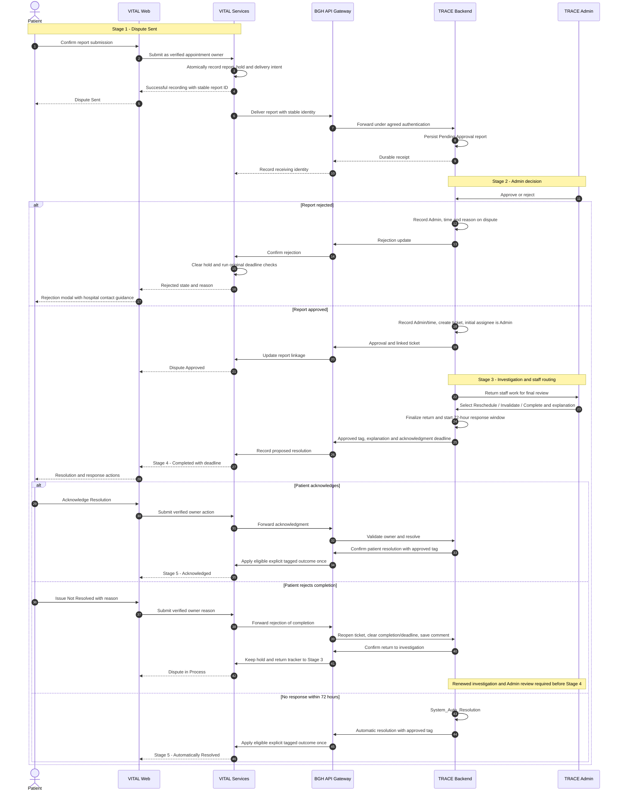

# VITAL–TRACE In-System Dispute Resolution Implementation Plan

**Target Systems:** `vital-services`, `vital-web`, `BGH_API_GATEWAY`, `TRACE_Backend`, `TRACE_Frontend`
**Reference Document:** [VITAL workflow agreement](VITAL_Feedback_on_TRACE_Integration_Plan.md)
**Document Status:** Agreed workflow; exact Gateway routes, payloads, and authentication contracts await confirmation
**Last Updated:** 21 November 2026

---

## 1. Executive Summary & Purpose

This document operationalizes the transition from the legacy Google Forms telemedicine dispute workflow to a **native in-system dispute resolution architecture**. It incorporates all architectural agreements, clarifications on boundaries and user permissions, UI/UX requirements for TRACE and VITAL, and explicit state machine transitions for dispute handling.

All VITAL–TRACE communications in both directions pass through **`BGH_API_GATEWAY`** with authenticated context and `X-Correlation-ID` propagation. The route names and field names below are illustrative contracts pending owner confirmation. This document describes planned implementation, with deployment acceptance still pending.

```
+---------------------------------------------------------------------------------------------------------+
|                                    BGH UNIFIED DISPUTE ARCHITECTURE                                     |
|                                                                                                         |
|   +-----------------------+              +-----------------------+              +-------------------+   |
|   |       VITAL Web       |              |    BGH API Gateway    |              |   TRACE Frontend  |   |
|   |  - Report Modal       |              |  - Route Auth & Proxy |              |  - Feedback Hub   |   |
|   |  - Progress Tracker   |              |  - Header Injection   |              |  - /dispute Queue |   |
|   |  - Acknowledge/Reject |              |  - Correlation ID     |              |  - Admin Approval |   |
|   +-----------+-----------+              +-----------+-----------+              +---------+---------+   |
|               |                                      |                                    |             |
|               v                                      v                                    v             |
|   +-----------+-----------+              +-----------+-----------+              +---------+---------+   |
|   |    VITAL Services     |<------------>|  Gateway Route Mesh   |<------------>|   TRACE Backend   |   |
|   |  - Hold State Machine |              |  /trace/api/disputes  |              |  - Pending Queue  |   |
|   |  - Original 48h Hold    |              |  /vital/api/disputes  |              |  - Ticket Engine  |   |
|   |  - Dispositions       |              |                       |              |  - 72h Scheduler  |   |
|   +-----------------------+              +-----------------------+              +-------------------+   |
+---------------------------------------------------------------------------------------------------------+
```

---

## 2. Core Clarifications & Architectural Agreements

### 2.1 VITAL Metadata & Clinical Privacy Boundary
* **Identifiers Transmitted**: VITAL supplies `appointment_id`, `doctor_id`, `patient_id`, and `reporter_auth_id` (Auth-owned UUID) as metadata.
* **Clinical Privacy Quarantine**: Doctor consultation notes, full EHR records, prescriptions, and medical certificates are **strictly excluded** from automatic transmission to TRACE. Only dispute-specific patient inputs (`subject`, `description`, `category_id`, and patient-chosen attachments) along with system identifiers are sent.

### 2.2 Dispute Report Submission & Admin Approval Queue

* Patient confirmation and successful VITAL recording atomically create the dispute, hold, and delivery intent. VITAL immediately shows **Dispute Sent**. Opening/cancelling the modal has no appointment effect. Failed VITAL recording retains the form with an error.
* Gateway delivery and retries run in the background with the same report ID. Preserve the hold while reconciliation is pending.
* TRACE stores the report in **Pending Approval**. Any authenticated TRACE Admin may approve or reject it.
* Approval records the deciding Admin and decision timestamp, creates one linked ticket, and sets the approving Admin as the initial assignee. Later HR / HIMD / IT / Accounting routing follows TRACE's workflow. The patient remains the original creator.
* Rejection records the deciding Admin, timestamp, and mandatory patient-visible reason as an action/comment on the dispute record, including when no ticket exists. VITAL displays **Dispute Rejected** and the rejection modal, clears the hold, and resumes the original completion deadline through normal payment and clinical-record checks. Preserve the original deadline; if it has passed, run those checks immediately.
* The modal states **Your dispute was rejected**, displays the reason, and offers **Close** with this guidance: “If you believe this decision was a mistake, please call [BGH contact number — pending] or visit [BGH address — pending].” The hospital will supply verified details before release.

### 2.3 VITAL Five-Stage Tracker & Patient Resolution

VITAL owns its progress bar. TRACE's internal ticket stages are grouped into Stage 3.

| Stage | Label | Agreed trigger |
| --- | --- | --- |
| 1 | **Dispute Sent** | Patient confirms and VITAL successfully records submission; delivery proceeds in the background. |
| 2 | **Dispute Approved or Rejected** | Admin decides. Approval continues to Stage 3; rejection ends this submission and shows the reason/contact modal. |
| 3 | **Dispute in Process** | Investigation and staff routing. The ticket returns to Admin for final review and a **Reschedule**, **Invalidate**, or **Complete** tag with an explanation. |
| 4 | **Completed** | VITAL receives the Admin-approved tag and explanation and shows the TRACE-supplied 72-hour acknowledgment deadline. |
| 5 | **Acknowledged** or **Automatically Resolved** | Patient acceptance or TRACE's 72-hour automatic resolution permits application of the explicit tagged outcome through VITAL's normal checks. Record which method resolved it. |

* Staff finishing work requires final Admin review before returning the resolution to the patient. TRACE starts the patient response window at the final Admin-approved completion/return and supplies `acknowledgment_deadline_at`. Internal staff completion before review cannot start automatic resolution.
* **Acknowledge Resolution** originates from the original patient inside VITAL, goes through Gateway to TRACE, and returns a confirmed resolution to VITAL.
* **Issue Not Resolved** requires a patient reason and follows the same Gateway path. TRACE changes Completed to Open, clears `completed_at` and `acknowledgment_deadline_at`, and saves the reason as a patient-attributed ticket comment. VITAL returns to Stage 3 and retains the hold. Renewed investigation requires another Admin review/tag before Stage 4 and a new deadline.
* After 72 hours without a patient response, TRACE resolves with `System_Auto_Resolution` and sends the approved tag and resolution method through Gateway. VITAL shows Automatically Resolved and applies that eligible outcome once. It does not record this as explicit patient acknowledgment.
* **Reschedule** maps to `reschedule_agreed` and starts VITAL's validated slot/confirmation workflow. **Invalidate** maps to `appointment_invalidated`. **Complete** maps to `appeal_dismissed` and resumes the original completion deadline/checks. Acceptance never bypasses payment, clinical-record, or current-state guards.
* Preserve decision IDs and superseding-decision links for corrections. Incompatible transitions, including reversal of a finalized appointment, go to VITAL Admin.
* Refund approval and actual external issuance remain separate from invalidation or ticket resolution. Accounting confirms issuance with a reconciliation reference. Mutual absence remains ineligible. Accounting's access to complaint narrative and evidence stays restricted.
* This 72-hour ticket response window is distinct from VITAL's original 48-hour consultation completion deadline.

### 2.4 Doctor Access & Ticket Log Boundaries
* **No Doctor Access**: Attending doctors do **not** have access to ticket logs or dispute management. The dispute is strictly between the patient and hospital administration.
* **Internal Log Masking**: Internal staff discussion, triage notes, and raw audit logs remain quarantined inside TRACE.
* **Patient View**: VITAL renders only a sanitized, high-level **Progress Tracker** on the appointment card/detail view. No ticket log export feature exists for patients or doctors.

### 2.5 TRACE Frontend UI Remodeling
1. **Patient Feedback Hub (`TRACE_Frontend/src/app/(private)/(authorized)/patient-feedback/page.tsx`)**:
   * Add a dedicated **Dispute Container Block** (styled identically to the *Staff Inactivity* container on `/dashboard`: white background, rounded border, header icon, scrollable card list).
   * Displays active dispute reports (pending approval and recently escalated).
   * Features a prominent **"View All"** button in the container header redirecting to `/dispute`.
2. **New Dedicated Dispute Queue Page (`TRACE_Frontend/src/app/(private)/(authorized)/dispute/page.tsx`)**:
   * Modeled after `TRACE_Frontend/src/app/(private)/(authorized)/departments/tickets/page.tsx`.
   * Built on `DisplayContainer`, featuring search, status filter pills (`All`, `Pending Approval`, `In Investigation`, `Completed`, `Resolved`), pagination, and export capabilities.

---

## 3. Detailed Dispute Lifecycle & State Machine



---

## 4. Component Changes & Implementation Specifications

### 4.1 `TRACE_Backend`

#### `app/modules/patient_form/models.py` & Database Migrations
* Extend `Patient_Dispute_Case`:
  * Ensure `intake_status` supports: `'pending_approval'`, `'approved_ticket_created'`, `'rejected'`, `'in_investigation'`, `'completed'`, `'resolved'`.
  * Persist the deciding Admin, decision timestamp, and `rejection_reason` when intake is rejected. The rejection action/comment belongs to the dispute even if `ticket_id` is absent.
  * Persist the final reviewing Admin, approved tag, patient-visible explanation, decision identity, and resolution method. Track the 72-hour window with `acknowledgment_deadline_at` and clear it on rejection of completion. Exact payload/storage names await confirmation.

#### `app/modules/patient_form/dispute_router.py` & `services.py`
* **Intake Endpoint**:
  * `POST /trace/api/disputes/intake`: Validates payload from Gateway, creates `Patient_Dispute_Case` in `pending_approval` state, returns `case_id`.
* **Triage / Approval Endpoint**:
  * `POST /trace/api/disputes/{case_id}/triage`:
    * If `action == "approve"`: Record Admin/time, create one linked ticket, and set that Admin as initial assignee. Subsequent department/staff routing follows TRACE. Preserve patient creator identity and set `approved_ticket_created`.
    * If `action == "reject"`: Require `rejection_reason`, record the deciding Admin/time and an action/comment on the dispute, set `rejected`, and send the patient-visible result through Gateway. This must work before any ticket exists.
* **Patient Rejection ("Issue Not Resolved") Endpoint**:
  * `POST /trace/api/disputes/{case_id}/reject-completion`:
    * Validate the original reporting patient through the agreed Auth-to-TRACE identity mapping, the active decision, and the linked ticket in `Completed` state. Patients with VITAL accounts can use this flow without TRACE staff permissions.
    * Updates ticket status from `Completed` to `Open`.
    * Clear `EmployeeTicketModel.completed_at` and `acknowledgment_deadline_at`, invalidate the pending completion proposal, and return the patient tracker to Stage 3. Require renewed Admin review/tag before Stage 4.
    * Creates a `CommentModel` on the ticket containing the patient's rejection reason.
    * Logs ticket update in `Ticket_Log`.
* **Dispute Progress Endpoint for Gateway**:
  * `GET /trace/api/disputes/{case_id}/progress`:
    * Return sanitized data for VITAL’s five-stage tracker, including the active approved tag/explanation, Admin decision timestamp, response deadline, resolution method, permitted actions, and event version. Confirm exact names with VITAL and Gateway.

---

### 4.2 `TRACE_Frontend`

#### 1. Patient Feedback Hub Update
**File:** `TRACE_Frontend/src/app/(private)/(authorized)/patient-feedback/page.tsx`
* Insert a new container card: **VITAL Telemedicine Disputes** styled like `/dashboard` Staff Inactivity:
  ```tsx
  <div className="bg-white border border-[#989898]/30 rounded-xl shadow-sm p-6 flex flex-col h-auto lg:h-[480px] min-h-[300px]">
    <header className="flex justify-between items-center mb-4 shrink-0">
      <div className="flex items-center gap-2">
        <AlertCircle className="text-amber-600" size={18} />
        <h4 className="text-lg font-semibold text-[#142608]">Telemedicine Disputes</h4>
      </div>
      <Link href="/dispute" className="px-3 py-1.5 bg-[#2F813E] text-white rounded-lg text-xs font-medium hover:bg-[#2F813E]/90 transition">
        View All
      </Link>
    </header>
    <div className="flex-1 overflow-y-auto pr-1 text-left space-y-3">
      {/* Scrollable list of pending and active dispute cards */}
    </div>
  </div>
  ```

#### 2. New Dedicated Dispute Queue Page
**File:** `TRACE_Frontend/src/app/(private)/(authorized)/dispute/page.tsx`
* Modeled on `TRACE_Frontend/src/app/(private)/(authorized)/departments/tickets/page.tsx`.
* Uses `DisplayContainer` with:
  * Filter pills: `All`, `Pending Approval`, `Active / In Investigation`, `Completed`, `Resolved`.
  * Search bar filtering by patient name, appointment reference, or dispute category.
  * Columns: Dispute ID, Appointment Ref, Category, Patient Auth ID, Intake Status, Submitted Date, Actions (Review, Approve, Reject). Show deciding Admin and decision time in the authorized detail view.
  * Admin triage records approval/rejection and makes the approving Admin initial assignee. Final review requires Reschedule, Invalidate, or Complete and a patient-visible explanation before returning the resolution.

---

### 4.3 `vital-services` & `vital-web`

#### `vital-services`
* **`POST /internal/v1/appointments/:id/appeal`**:
  * Validates patient ownership and appointment eligibility.
  * Sets `reviewHold = true`, `status = 'in_review'`.
  * Record Dispute Sent on successful patient-confirmed submission. Persist delivery intent atomically and dispatch through Gateway with retries using the same report ID.
* **`POST /internal/v1/appointments/appeals/reject-completion`**:
  * Invoked by patient when selecting "Issue not resolved".
  * Calls Gateway `POST /trace/api/disputes/{case_id}/reject-completion`.
  * Retains `reviewHold = true` and `status = 'in_review'`.
* **`POST /internal/v1/appointments/appeals/receipt-rejected`**:
  * Ingests admin rejection callback from TRACE.
  * Clear the hold and resume the original completion deadline through existing payment/clinical-record checks. If elapsed, run the checks immediately without extending the deadline.

#### `vital-web`
* **Appointment Detail View**:
  * Render VITAL’s own five-stage Dispute Tracker using the agreed labels in Section 2.3. Show Dispute Sent after successful local recording, including while delivery is retried.
  * At Stage 4, display Admin’s approved tag/explanation and countdown to TRACE’s `acknowledgment_deadline_at`. At Stage 5, distinguish patient acknowledgment from automatic resolution.
  * On intake rejection, show the reason/contact modal and Dispute Rejected. Phone and address remain pending hospital confirmation.
  * Render two primary actions:
    1. **"Acknowledge Resolution"** (Success button).
    2. **"Issue Not Resolved"** (Warning/Destructive button) $\rightarrow$ opens modal requesting reason, dispatches rejection to TRACE to reopen ticket.

---

## 5. Verification & Test Plan

### 5.1 Unit & Integration Tests
* **`TRACE_Backend`**:
  * Test intake creation: verify `intake_status == 'pending_approval'` and no ticket is prematurely created.
  * Test triage approval: verify one ticket is linked to the dispute, deciding Admin/time are recorded, and that Admin is initial assignee while patient creator identity is retained.
  * Test triage rejection before ticket creation: require a reason, record the Admin/time and dispute action/comment, and deliver rejection through Gateway.
  * Test patient rejection: verify Completed to Open, clear completion/deadline, record a patient comment, return to Stage 3, and require renewed Admin review/tag before Stage 4.
  * Test scheduler: final Admin-approved completion starts the 72-hour response window. Automatic resolution returns its method and approved tag; reopened tickets and staff work awaiting Admin review are untouched.
* **`vital-services`**:
  * Verify `startAppeal` atomically flags `reviewHold = true` and halts completion maintenance worker.
  * Verify intake rejection preserves the original deadline, clears the hold, and runs normal completion checks even when that deadline has elapsed.
  * Verify "Issue Not Resolved" retains hold.
* **`TRACE_Frontend`**:
  * Verify Dispute Container renders on `/patient-feedback`.
  * Verify "View All" navigates to `/dispute`.
  * Verify `/dispute` filters correctly between Pending Approval, Active, and Resolved cases.

### 5.2 Manual End-to-End Walkthrough

1. Sign in as the patient who owns an eligible telemedicine appointment awaiting completion confirmation.
2. Open and cancel the report modal; verify the appointment is unchanged. Then confirm a valid report and verify **Dispute Sent** immediately after VITAL records it.
3. Simulate unavailable delivery; verify the report ID and hold persist while retries recover one TRACE report.
4. TRACE Admin approves the report. Verify the deciding Admin/time, that Admin as initial assignee, the retained patient creator, and **Dispute Approved** in VITAL.
5. Investigate and route work in TRACE while VITAL shows **Dispute in Process**. Return staff work to Admin, who selects Reschedule, Invalidate, or Complete with an explanation.
6. Verify VITAL shows **Completed**, the approved tag/explanation, and TRACE's 72-hour deadline only after final Admin review.
7. Select **Issue Not Resolved** with a reason. Verify a patient-attributed ticket comment, Open state, cleared completion/deadline, retained hold, and Stage 3.
8. Investigate again and obtain renewed Admin review/tag. Verify Stage 4 and a fresh deadline.
9. Acknowledge as the original patient. Verify the confirmed Gateway round trip, Stage 5 **Acknowledged**, and one eligible tagged outcome. Separately exercise expiry and verify **Automatically Resolved** with the approved tag.
10. Reject another intake before ticket creation. Verify its dispute action/comment, deciding Admin/time, patient modal, pending phone/address configuration, and original completion checks.
11. Verify wrong-patient actions are denied, doctors cannot access ticket logs, internal comments stay private, Accounting evidence restrictions hold, and refunds remain separate from invalidation.
